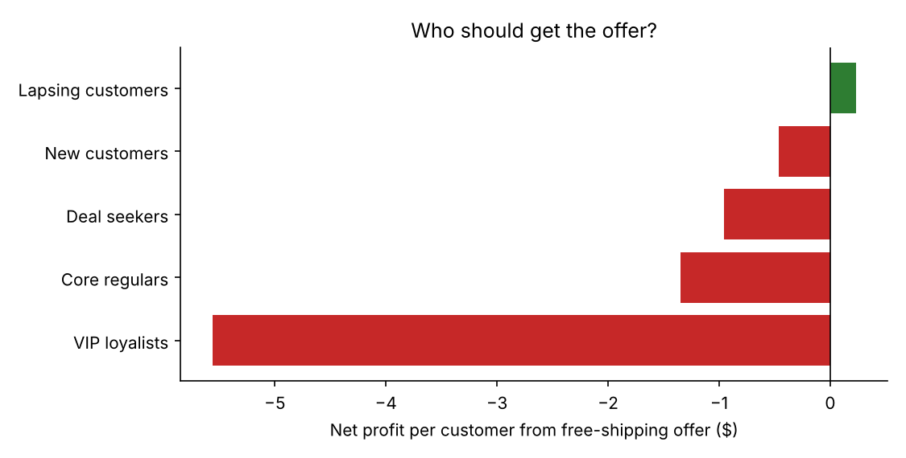
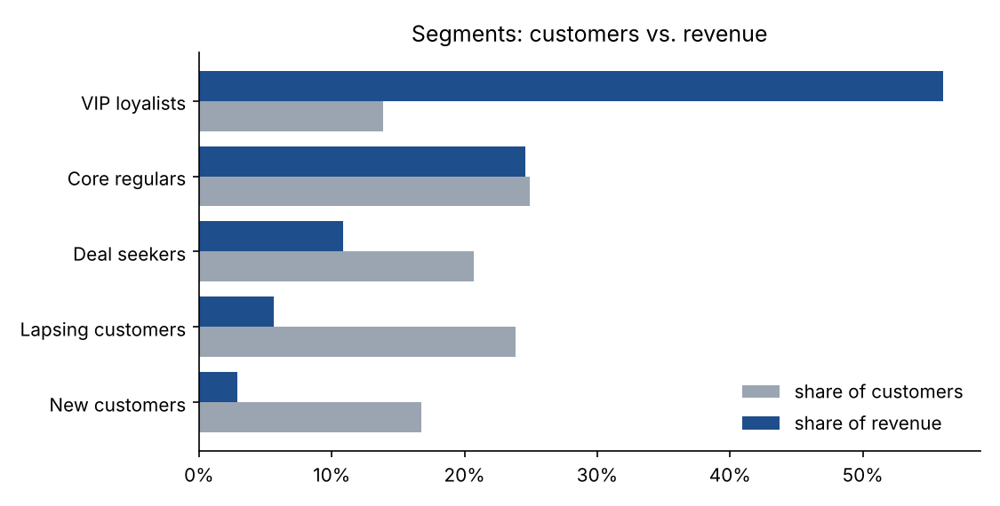
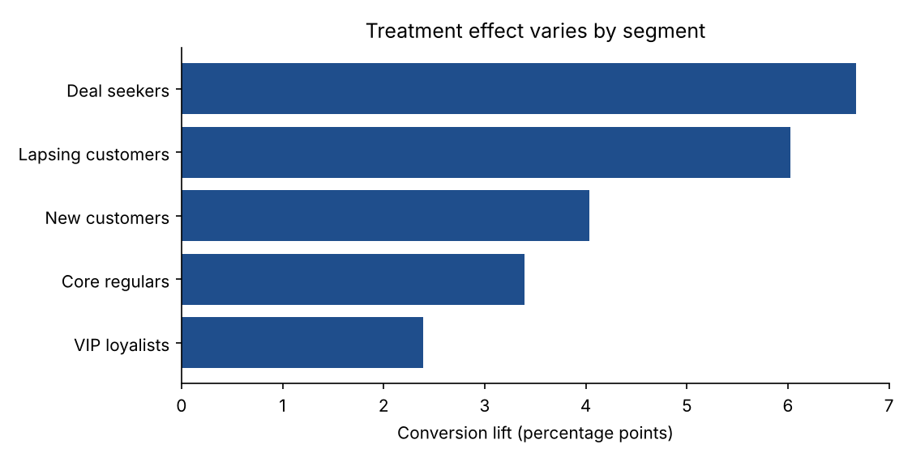

# Customer Segmentation + A/B Testing: A Winning Test That Would Have Lost Money

An e-commerce company tested a free-shipping offer. It **lifted conversion by 5 points, highly significant.** Rolling it out to everyone would have **lost money**. This project segments the customer base, analyzes the experiment properly, and shows where the offer pays for itself.

   

> **Data note:** all data is synthetic, produced by [`data/generate_data.py`](data/generate_data.py): 40,000 customers with 12 months of purchase behavior, randomly split 50/50 into control and a free-shipping offer, with 30-day outcomes. Hidden customer types drive both behavior and offer response, so the segmentation has real structure to find. The generator never reveals those types to the analysis.

---

## Results at a glance

| | |
|---|---|
| **Randomization check** | Passed. Sample-ratio-mismatch p = 0.20 (19,871 control / 20,129 treatment). |
| **Conversion** | 20.5% → 25.5%, **+5.0 pts** (95% CI 4.2 to 5.8), p < 0.001 |
| **Revenue per customer (CUPED-adjusted)** | $28.79 → $31.74, **+$2.95** (95% CI $1.40 to $4.51) |
| **Variance reduction from CUPED** | **26%**, equivalent to running the test with about a third more customers |
| **Offer to everyone** | **−$1,326 net profit per 1,000 customers** |
| **Offer to lapsing customers only** | **+$55 per 1,000 customers**, and stops the losses in the other four segments |

**The headline:** statistical significance isn't the same as business value. Free shipping is paid on *every* order a treated customer places, including orders they would have placed anyway. For high-value customers, that subsidy costs far more than the extra purchases it brings in.



## Part 1: Segmentation

### Approach
Eight behavioral features (recency, frequency, revenue, average order value, discount share, tenure, email engagement, return rate) are log-transformed where skewed, standardized, and clustered with K-means.

**Choosing k:** the silhouette score falls steadily from k=3 and is nearly flat between 4 and 6 ([chart](reports/figures/choose_k.png)), which is typical for behavioral data with no hard boundaries. In that range, k is a business decision. **k = 5** separates top spenders from steady regulars, two groups a marketing team treats differently. Segments are named automatically from their profiles ([code](src/custsegab/segmentation.py)).

### The segments

| Segment | Customers | Revenue share | Median recency | Orders / yr | Median AOV | Discount share |
|---|---|---|---|---|---|---|
| **VIP loyalists** | 14% | **56%** | 9 days | 13 | $116 | 19% |
| **Core regulars** | 25% | 25% | 24 days | 6 | $66 | 30% |
| **Deal seekers** | 21% | 11% | 32 days | 5 | $41 | **77%** |
| **Lapsing customers** | 24% | 6% | **140 days** | 1 | $53 | 36% |
| **New customers** | 17% | 3% | 36 days | 1 | $45 | 40% |



## Part 2: The experiment

### Before analyzing: is the test valid?
- **Sample ratio mismatch check:** a chi-square test on group sizes (p = 0.20). If this fails, the randomization is broken and nothing downstream can be trusted.
- **Power:** at a 20.5% baseline with about 20,000 customers per group, the minimum detectable effect is **1.1 percentage points** (80% power, α = 0.05). A 2-point lift would have needed only 6,632 per group. The test was well powered.

### Overall effect
- **Conversion** uses a two-proportion z-test.
- **Revenue** uses Welch's t-test, since revenue is heavily skewed and the group variances differ, along with **CUPED** (Controlled-experiment Using Pre-Experiment Data). CUPED adjusts each customer's revenue by their spending before the test. It's unbiased because pre-period spend can't be affected by the treatment, and it cuts variance by 26%. It also corrects a small chance imbalance: the unadjusted estimate (+$3.66) was slightly inflated by the treatment group happening to include a few more high spenders.

### Effects by segment
The offer helps every segment's conversion, but by very different amounts:



| Segment | Conv. lift | Incremental revenue / customer | Shipping cost / customer | **Net profit / customer** |
|---|---|---|---|---|
| Lapsing customers | +6.0 pts | +$3.23 | $1.06 | **+$0.23** ✅ |
| New customers | +4.0 pts | +$1.14 | $0.92 | −$0.47 |
| Deal seekers | +6.7 pts | +$2.25 | $1.86 | −$0.96 |
| Core regulars | +3.4 pts | +$2.49 | $2.34 | −$1.35 |
| VIP loyalists | +2.4 pts* | +$6.03* | $7.97 | **−$5.56** |

\* Not significant after Holm correction for testing five segments (p = 0.07 for conversion, 0.25 for revenue).

Net profit = 40% gross margin × incremental revenue − $8 shipping subsidy × orders placed by treated customers. Both assumptions are parameters in [`pipeline.py`](src/custsegab/pipeline.py).

### The story the segments tell
- **VIP loyalists** were going to buy anyway, with 59% converting without any offer. Free shipping mostly subsidizes orders that were already coming.
- **Deal seekers** respond the most (+6.7 pts), but their small baskets don't cover the shipping cost.
- **Lapsing customers** respond strongly *and* rarely buy without an offer, so nearly every order they place is new revenue. They're the only segment where the offer pays.

### Recommendation
1. **Don't roll out free shipping to everyone.** The test was a statistical win, but it would lose about $1,300 per 1,000 customers per month.
2. **Target lapsing customers** as a win-back program. The margin is thin ($0.23 per customer), so…
3. **…run a follow-up test inside that segment** with a minimum-order threshold (for example, free shipping over $50). That raises basket size and should widen the margin.

## Repository structure

```
├── data/generate_data.py           # synthetic customers + randomized experiment
├── src/custsegab/
│   ├── segmentation.py             # features, k selection, K-means, profiling, naming
│   ├── experiment.py               # SRM, power/MDE, z-test, Welch, CUPED, Holm
│   └── pipeline.py                 # end-to-end analysis + economics + figures
├── reports/                        # metrics.json, figures/, tables/
├── tests/                          # statistical method tests
└── Makefile
```

## Run it yourself

```bash
git clone https://github.com/chatnic/customer-segmentation-ab-testing.git
cd customer-segmentation-ab-testing
python -m venv .venv && source .venv/bin/activate
make setup
make all      # generate data -> segment -> analyze -> tests (~15 seconds)
```

## What I'd do next in a real engagement

- **Use uplift modeling instead of fixed segments.** Score each customer's individual treatment effect and target the most profitable ones (see my [pricing-uplift-modeling](https://github.com/chatnic/pricing-uplift-modeling) project).
- **Look past 30 days.** Check whether the offer pulled purchases forward from next month, or changed long-term behavior.
- **Use sequential testing** so the experiment can stop early without inflating false positives.

## License

MIT. See [LICENSE](LICENSE).
